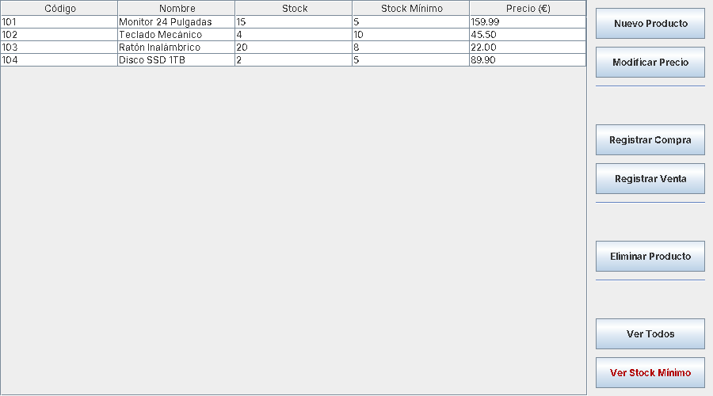

# Gestión de almacén (CRUD) · Java + Swing

Aplicación de escritorio para gestionar el inventario de un almacén, desarrollada en el módulo de Programación del CFGS de Desarrollo de Aplicaciones Web.

## Funcionalidades
- Alta, modificación de precio y eliminación de productos
- Registro de compras y ventas con actualización automática del stock
- Listado de todos los productos
- Consulta de productos por debajo del stock mínimo

## Diseño
La capa de datos está desacoplada de la interfaz gráfica mediante la interfaz `ModeloAbs`, con dos implementaciones intercambiables:
- `ModeloArrayList`: almacena los productos en una lista
- `ModeloHashMap`: almacena los productos indexados por código, para búsquedas más rápidas

Así se puede cambiar la forma de guardar los datos sin tocar la interfaz gráfica.

## Tecnologías
Java · Swing · Eclipse IDE

## Cómo ejecutarlo
1. Clona el repositorio e impórtalo en Eclipse como proyecto Java existente.
2. Ejecuta `gestionalmacen01.principal.AlmacenGUI` (interfaz gráfica) o `MiAlmacen` (versión de consola).

## Captura

## Autor
Carlos Alberto García Espinoza. La interfaz `ModeloAbs` parte de la estructura proporcionada en el módulo.
